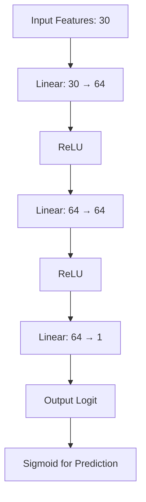
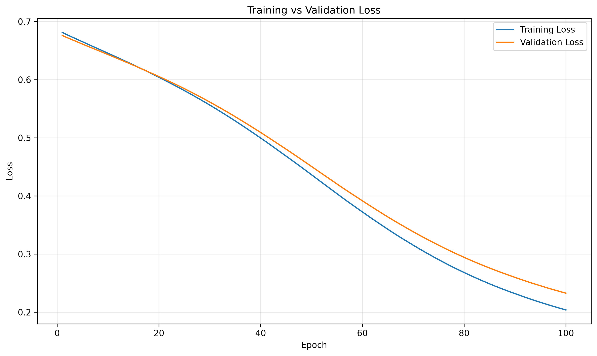

# Breast Cancer Classifier

A modular binary-classification project built with PyTorch and scikit-learn. This project explores the complete machine-learning workflow, from data preparation and neural-network implementation to model training, validation, evaluation, and visualization.

The main goal is to develop a practical understanding of neural-network training, backpropagation, optimization, and model evaluation through a hands-on project.

> **Note:** This is an educational machine-learning project, not a clinically validated diagnostic tool.

## Dataset

This project uses the Breast Cancer Wisconsin dataset available through `sklearn.datasets.load_breast_cancer()`.

| Property | Description |
|---|---|
| Samples | 569 |
| Input features | 30 numeric features |
| Target classes | Malignant and benign |
| Label `0` | Malignant |
| Label `1` | Benign |
| Task | Binary classification |

The target encoding is important when interpreting the evaluation metrics. In this project, malignant (`0`) is treated as the positive class when calculating precision, recall, and F1-score.

## Project Structure

```text
breast-cancer-classifier/
├── EDA.ipynb
├── README.md
├── requirements.txt
├── data.py
├── model.py
├── train.py
├── evaluate.py
├── plotting.py
├── experiments.py
├── images/
│   └── loss_curve.png
└── plot/
    ├── confusion_matrix_0.003.png
    ├── confusion_matrix_0.03.png
    ├── correlation_heatmap.png
    ├── feature_distributions.png
    ├── learning_rate_comparision.png
    └── target_distribution.png
```

| File | Responsibility |
|---|---|
| `data.py` | Load the dataset, split the data, scale features, and create PyTorch datasets |
| `model.py` | Define the neural-network architecture |
| `train.py` | Prepare data loaders, train the model, track validation loss, restore the best checkpoint, and run the main workflow |
| `evaluate.py` | Generate predictions and calculate classification metrics and a confusion matrix |
| `plotting.py` | Visualize training and validation loss and compare experiment histories |
| `experiments.py` | Provide reusable functions for controlled training experiments |

## Model Architecture

The classifier is a fully connected neural network with two hidden layers and ReLU activation functions.



### Architecture Details

- **Input layer:** 30 features
- **Hidden layer 1:** 64 neurons with ReLU activation
- **Hidden layer 2:** 64 neurons with ReLU activation
- **Output layer:** 1 neuron
- **Trainable parameters:** 6,209

The final layer outputs a logit rather than a probability. `BCEWithLogitsLoss` handles the logit-based loss calculation during training. During prediction, sigmoid converts the output logit into a probability.

## Pipeline: Raw Data to Predictions

### 1. Load Data

The `load_data()` function in `data.py` loads the dataset using scikit-learn.

The features and labels are converted into NumPy `float32` arrays for subsequent processing.

### 2. Split Data

The `split_data()` function divides the dataset into training, validation, and test sets.

- **Training set:** 64% of the full dataset
- **Validation set:** 16% of the full dataset
- **Test set:** 20% of the full dataset

The test set is separated first. Then, 20% of the remaining data is allocated to validation.

Stratified splitting helps preserve the class proportions across the three sets.

### 3. Scale Features

`StandardScaler` standardizes the input features.

The scaler is fitted only on the training data. The same learned mean and standard deviation are then applied to the validation and test sets.

This prevents data leakage from the held-out sets during preprocessing.

### 4. Create PyTorch Datasets and DataLoaders

The processed NumPy arrays are converted into PyTorch tensors and wrapped in `TensorDataset` objects.

Labels are reshaped to `(number_of_samples, 1)` to match the model's output shape.

`DataLoader` divides the data into mini-batches. Training batches are shuffled, while validation and test batches are not.

### 5. Train the Model

The `train.py` module implements the training process.

For each training batch:

1. Clear the previous gradients using `optimizer.zero_grad()`.
2. Perform a forward pass through the network.
3. Calculate the loss using `BCEWithLogitsLoss`.
4. Calculate gradients using `loss.backward()`.
5. Update the model parameters using `optimizer.step()`.

This process repeats across the training batches and epochs.

### 6. Validate and Restore the Best Checkpoint

After every epoch, the model's validation loss is calculated.

The training function tracks the epoch with the lowest validation loss and stores a copy of the corresponding model weights.

After training finishes, those best-validation weights are restored.

This implementation uses **best-checkpoint restoration**, not early stopping. Training continues for the configured number of epochs.

### 7. Evaluate the Model

The `evaluate.py` module evaluates the restored model on the held-out test set.

The model produces logits, which are converted into probabilities using `torch.sigmoid()`.

A threshold of `0.5` is used to convert probabilities into predicted classes.

The evaluation reports:

- Accuracy
- Precision
- Recall
- F1-score
- Confusion matrix

Precision, recall, and F1-score use malignant (`0`) as the positive class.

A false negative in this setting occurs when an actual malignant sample is predicted as benign.

### 8. Visualize Training

The `plotting.py` module provides functions to visualize training and validation loss.

These plots help inspect:

- Whether loss decreases during training
- Whether training plateaus
- Whether loss fluctuates
- Whether training and validation loss diverge
- How different experiment configurations compare

## Training Configuration

The main training script currently uses the following configuration.

| Parameter | Value |
|---|---|
| Framework | PyTorch |
| Model | Fully connected neural network |
| Input features | 30 |
| Hidden layers | 2 |
| Hidden units | 64 per hidden layer |
| Activation | ReLU |
| Output units | 1 |
| Loss function | `BCEWithLogitsLoss` |
| Optimizer | Stochastic Gradient Descent (SGD) |
| Learning rate | `0.003` |
| Batch size | `32` |
| Maximum epochs | `100` |
| Checkpoint selection | Lowest validation loss |
| Prediction threshold | `0.5` |

## Results

| Metric | Test Result |
|---|---:|
| Accuracy | 0.9386 |
| Precision (malignant class) | 0.9487 |
| Recall (malignant class) | 0.8810 |
| F1-score (malignant class) | 0.9136 |

The model checkpoint is selected using validation loss. The final evaluation is performed on the held-out test set.

These results represent one data split and should not be interpreted as evidence of clinical diagnostic performance.

## Training Curves




## Experiments

The `experiments.py` module provides reusable functions for controlled experiments.

### Available Functions

- `prepare_data(batch_size=32)`: prepares training and validation data loaders.
- `run_experiment(...)`: trains a new model from supplied initial weights using a specified learning rate.

The currently commented experiment runner compares batch sizes `16`, `32`, and `64` while keeping the learning rate fixed at `0.03`.

The same initial model weights are used across the experiments to make comparisons more meaningful.

The experiment runner is currently commented out and must be enabled before it can execute.

**Note:** `plot_learning_rate_comparison()` expects results organized by learning rate, whereas the current commented experiment runner organizes results by batch size. The result structure or plotting function must be adapted before using them together.

## Key Learnings

This project provides hands-on practice with:

- Implementing a neural network using `torch.nn.Module`
- Understanding forward passes and neural-network outputs
- Understanding logits and probability conversion
- Working with loss functions and binary classification
- Using autograd to calculate gradients
- Understanding backpropagation and optimizer updates
- Training neural networks with mini-batches
- Tracking training and validation loss
- Preventing data leakage during feature scaling
- Restoring the best validation checkpoint
- Evaluating binary classification using precision, recall, F1-score, and a confusion matrix
- Structuring a machine-learning project into reusable Python modules

## How to Run

Install the required dependencies:

```bash
pip install -r requirements.txt
```

Run the main training pipeline:

```bash
python train.py
```

The script prepares the data, trains the model, prints training and validation loss information, evaluates the model on the test set, and displays the loss plot.

## Limitations

- This project is for educational purposes and is not a medical diagnostic tool.
- Results are based on one train/validation/test split.
- The classification threshold is fixed at `0.5`.
- The model and fitted scaler are not yet packaged as a reusable inference pipeline.
- The fitted scaler and trained model are not currently saved as deployment artifacts.
- Model initialization is not explicitly seeded in the main training workflow, so results may vary between runs.
- Test performance alone does not establish clinical validity, robustness, or generalization to new patient populations.

## Future Improvements

Possible future extensions include:

- Aligning the experiment result structure with the plotting functions.
- Saving the trained model and fitted scaler for future inference.
- Improving evaluation reports and confusion-matrix visualization.
- Exploring additional validation methods if the project scope expands.

The current focus is on understanding and documenting the complete machine-learning pipeline before adding more complexity.

---

**Built with:** Python, PyTorch, NumPy, scikit-learn, and Matplotlib.